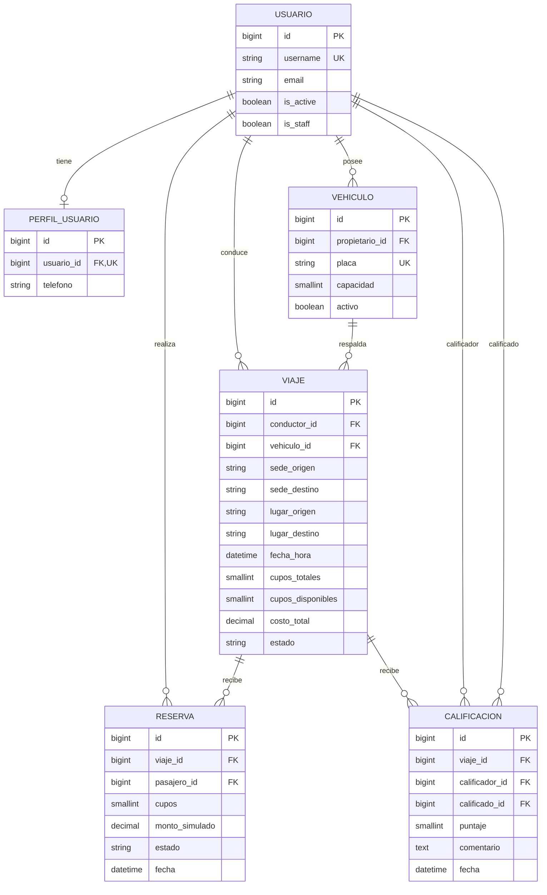

# RaidU: documento técnico

## Proceso y módulos

El proceso común es registro → vehículo → publicación de viaje → reserva y reparto
del costo → ejecución y finalización → calificación. Una cuenta puede conducir
un viaje y ser pasajera en otro. La API es Django REST Framework con tokens y MySQL.

| App | Entradas | Salidas y responsabilidad |
| --- | --- | --- |
| usuarios | Correo UCR, contraseña y perfil | Cuenta, token, perfil, listado y baja lógica |
| vehiculos | Placa, marca, modelo y capacidad | Vehículos propios que respaldan los viajes |
| viajes | Vehículo, sedes, horario, cupos y costo | Oferta de transporte y estado del viaje |
| reservas | Viaje y cupos | Reserva, cupos restantes y aporte simulado |
| calificaciones | Viaje, destinatario, puntaje y comentario | Valoración entre participantes y promedio |

## Diagrama relacional

Los ids son claves primarias generadas. Las relaciones apuntan al usuario de Django.

Reserva materializa la relación N:M Usuario ↔ Viaje, con unicidad `(viaje, pasajero)`.
Calificación tiene unicidad `(viaje, calificador, calificado)`. Los tokens y grupos
son tablas de autenticación estándar, omitidas del diagrama de negocio.

## Integridad y borrado

- Perfil → Usuario, Vehículo → propietario, Viaje → conductor/vehículo y Reserva →
  viaje/pasajero usan `PROTECT`. La baja de usuario cambia `is_active=False`, revoca
  tokens y conserva las relaciones.
- Un vehículo o viaje con relaciones protegidas devuelve 409 al intentar borrarlo.
  Se conservan todos los viajes con historial de reservas, incluso canceladas.
- DELETE Reserva cancela y devuelve 204; repetirlo no libera cupos otra vez.
- Calificación usa `CASCADE` para sus relaciones, como en el módulo existente.
  La API de usuarios no borra físicamente cuentas y las reservas protegen el viaje.
- La base restringe capacidad positiva, sedes distintas, costo positivo, rango de
  cupos disponibles, estados de viaje/reserva y unicidades. Puntaje 1–5 se valida en API.

## Reglas verificables

| Regla | Comportamiento | HTTP y prueba |
| --- | --- | --- |
| RN-01 | Registro con correo `@ucr.ac.cr` y contraseña válida | 400; usuarios |
| RN-02 | Cupos solicitados no superan disponibles | 409; reservas, incluyendo simultáneas |
| RN-03 | Conductor no reserva su propio viaje | 400; reservas y Postman |
| RN-04 | Una reserva por pasajero/viaje, incluso cancelada | 409; reservas y restricción única |
| RN-05 | Viajes nuevos con fecha futura y estado publicado | 400; viajes |
| RN-06 | Vehículo del conductor y capacidad suficiente | 400; viajes, también PATCH |
| RN-07 | Calificación solo en viaje finalizado, entre participantes, sin autocalificación y puntaje 1–5 | 400; calificaciones |
| RN-08 | No reducir capacidad por debajo de lo reservado ni modificar viajes cerrados | 400; viajes/reservas |

Los filtros reconocidos se validan antes de llegar al ORM; enteros, fechas, estados y
ordenamientos inválidos devuelven 400. No se interpolan valores del cliente en SQL.

## Permisos

Anónimos obtienen 401 en operaciones protegidas; autenticados sin permiso obtienen 403.
Administrador significa `is_staff=True`. `usuarios/permisos.py` centraliza Soporte y
da prioridad al administrador si también pertenece al grupo Soporte.

| Operación | Usuario | Soporte | Administrador |
| --- | --- | --- | --- |
| Registro y obtención de token | Público | Público | Público |
| Consultar/editar perfil propio | Sí | Sí | Sí |
| Listar usuarios | No | Sí | Sí |
| Baja lógica | Cuenta propia | No | Cualquier cuenta |
| Consultar vehículos | Propios | Todos | Todos |
| Crear/editar/borrar vehículos | Propios | No | Todos; creación para sí mismo |
| Consultar viajes | Todos | Todos | Todos |
| Crear/editar/borrar viajes | Propios | No | Todos; creación para sí mismo |
| Consultar reservas | Propias | Todas | Todas |
| Crear/editar/cancelar reservas | Propias | No | Todas; creación para sí mismo |
| Consultar calificaciones/promedios | Sí | Sí | Sí |
| Crear calificaciones | Si participó | No | Si participó |
| Editar/borrar calificaciones | Autor | No | Todas |

## Transacciones y reparto

Las escrituras de reservas y del detalle de viajes bloquean primero la fila del viaje
con `select_for_update` dentro de una transacción. Así dos solicitudes por el último
cupo se serializan: una confirma y la otra obtiene 409. Se vuelve a leer la reserva
después del bloqueo para que cancelaciones simultáneas no liberen cupos dos veces.
Los permisos se comprueban antes de escribir.

El costo se reparte por cupos confirmados sin contar al conductor. Una reserva de
dos cupos paga dos partes. Se recalcula al crear/modificar/cancelar una reserva o
cambiar el costo del viaje. La última reserva por id recibe los centavos restantes
para mantener la suma exacta. Cancelar un viaje cancela sus reservas y deja monto cero.
No se permite cambiar el viaje o titular de una reserva ni reactivarla.

## Consultas ORM

| Consulta | Ubicación | Propósito |
| --- | --- | --- |
| `Q(placa...) \| Q(marca...) \| Q(modelo...)` | vehiculos/views.py | Búsqueda con alternativas y límite por propietario |
| Filtros combinables y `order_by` | viajes/views.py | Oferta por sedes, fecha, estado y cupos |
| `select_related('viaje', 'pasajero')` y filtros por usuario | reservas/views.py | Listado con relaciones y permisos |
| `Sum('cupos')` de reservas confirmadas | viajes/views.py | Proteger cupos ocupados al modificar capacidad |
| `Avg('puntaje')` y `count()` | calificaciones/views.py | Promedio y cantidad de valoraciones recibidas |
| `select_related('perfil')` | usuarios/views.py | Listado de cuentas con su perfil |

## Catálogo de endpoints y errores

| Ruta | Métodos |
| --- | --- |
| `/api/token/` | POST |
| `/api/usuarios/registro/` | POST |
| `/api/usuarios/` | GET |
| `/api/usuarios/<id>/` | DELETE (baja lógica) |
| `/api/perfil/` | GET, PATCH |
| `/api/vehiculos/` y `/<id>/` | GET/POST; GET/PUT/PATCH/DELETE |
| `/api/viajes/` y `/<id>/` | GET/POST; GET/PUT/PATCH/DELETE |
| `/api/reservas/` y `/<id>/` | GET/POST; GET/PUT/PATCH/DELETE (cancelación) |
| `/api/calificaciones/` y `/<id>/` | GET/POST; GET/PUT/PATCH/DELETE |
| `/api/calificaciones/promedio/<usuario_id>/` | GET |

200 consulta/actualización, 201 creación, 204 baja/borrado/cancelación, 400 datos o
reglas inválidas, 401 falta de autenticación, 403 falta de permiso, 404 inexistente,
409 duplicado de reserva, falta de cupos o borrado protegido. Los errores de reglas
usan el nombre del campo o `detail`; nunca requieren mostrar una traza interna.

Viajes/reservas/calificaciones comparten `config/paginacion.py`: 10 elementos,
`pagina_actual`, `total_paginas`, `total_registros`, `resultados`; `get_page` ajusta
páginas inválidas. Usuarios/vehículos conservan su contrato previo (`count`, `page`,
`total_pages`, `results`) y devuelven 404 para página inválida. Ambos contratos están
documentados; no se cambian respuestas existentes al centralizar la función compartida.

## Decisiones frente al plan inicial y límites

Se usan cuatro sedes enumeradas y detalles opcionales, sin modelo Lugar. El estado
inicial se controla en API y los cambios posteriores siguen las transiciones del
módulo de viajes. Se conserva la edición/borrado de calificaciones del módulo
existente para corregir valoraciones, con permiso del autor o administrador; difiere
del borrador inicial que proponía omitir esas operaciones.

Las cuentas se desactivan, las reservas se cancelan y los pagos son simulados.
Los acompañantes de una reserva no se identifican individualmente; solo su titular
participa como usuario en calificaciones. No hay frontend, cobros ni notificaciones.
